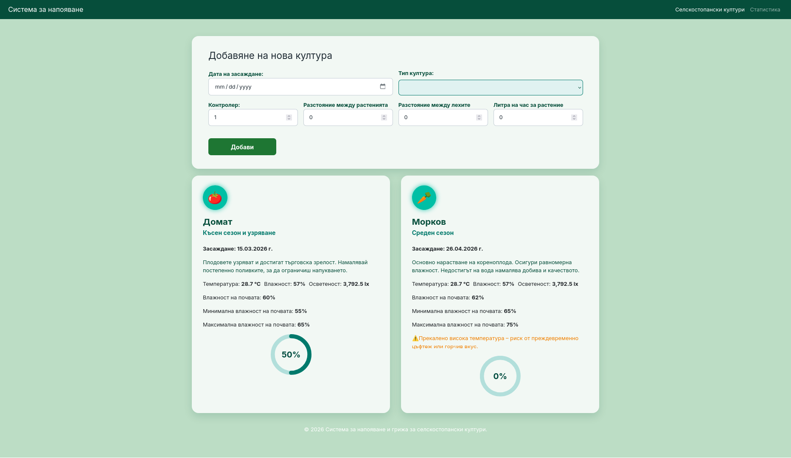
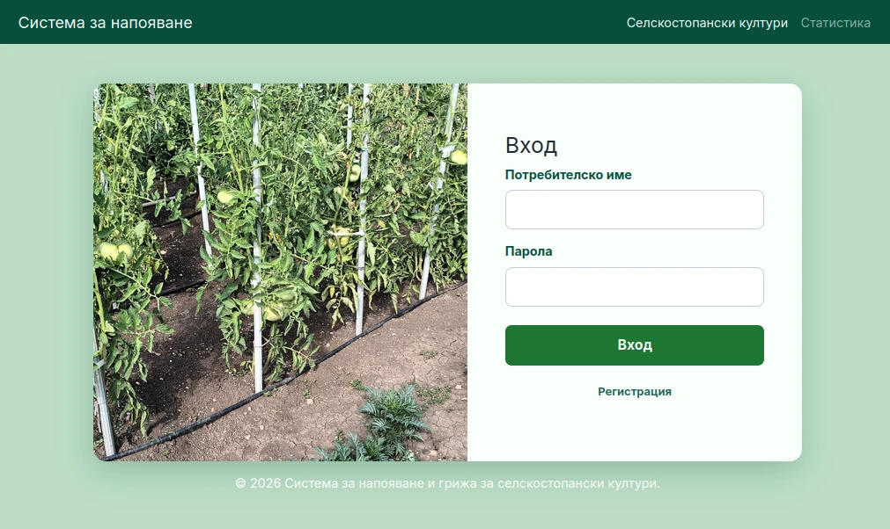
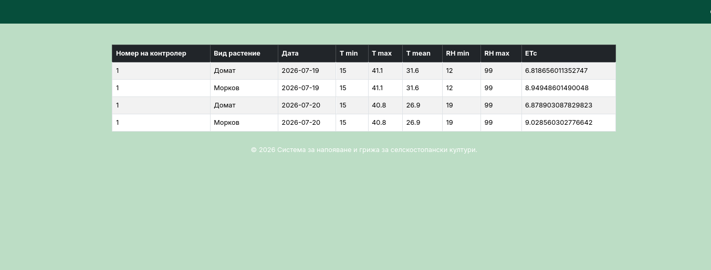
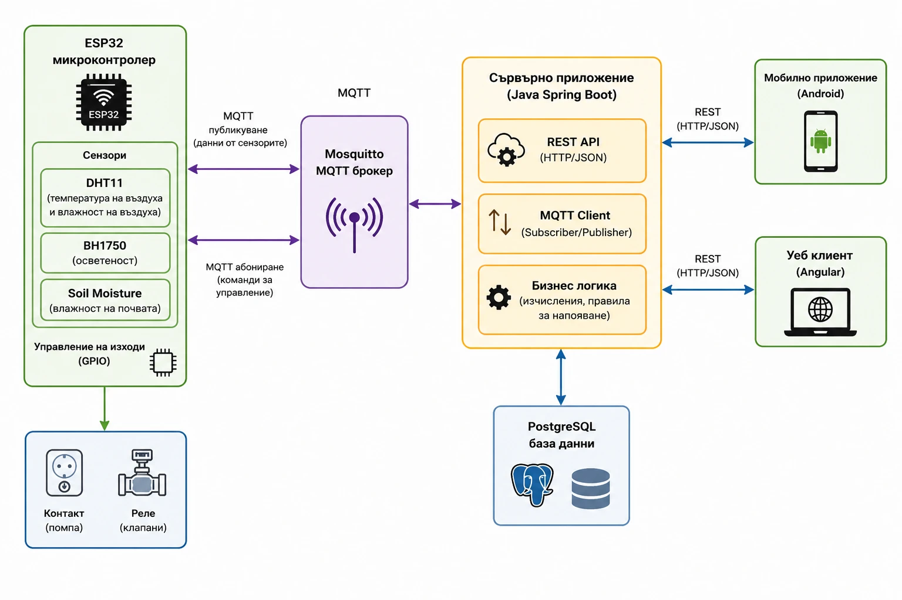
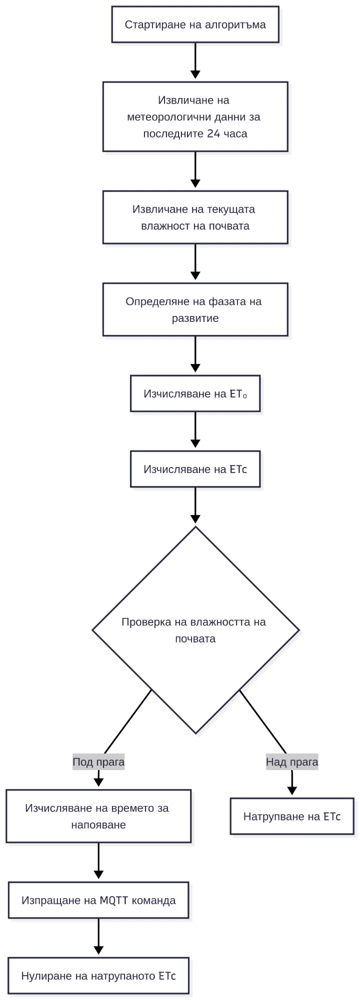
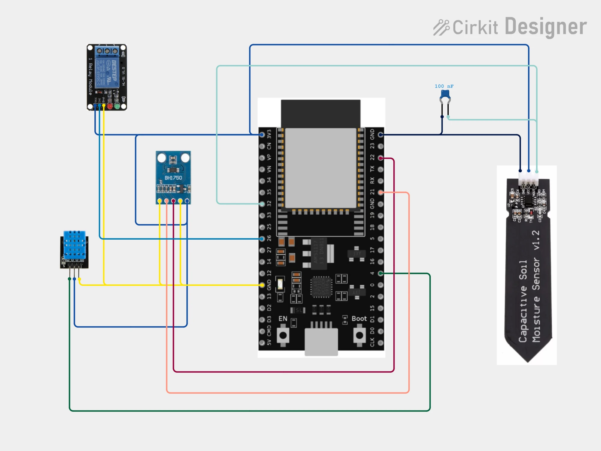
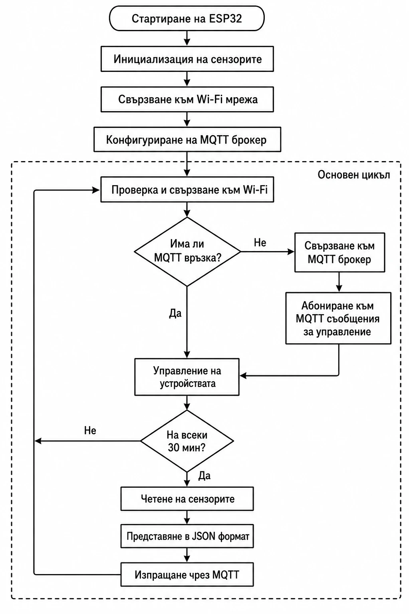
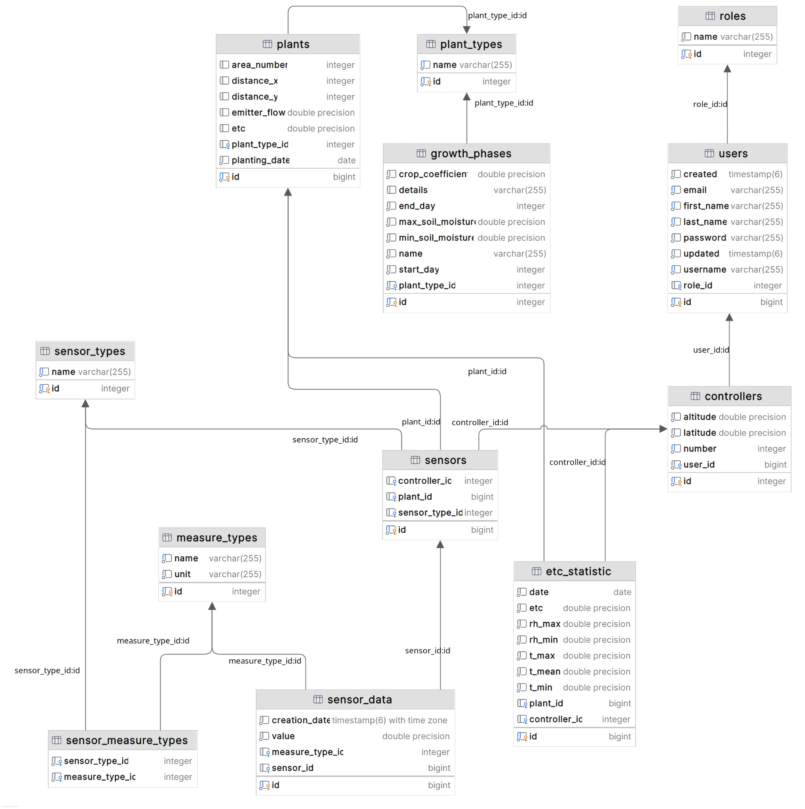

# IrrigationSystem

An IoT system that waters each plant according to how much water it has actually lost. An ESP32 in the
garden measures temperature, humidity, light and soil moisture and sends the readings over MQTT. Every day
the backend works out each plant's crop evapotranspiration (ETc), the water it lost, using the FAO‑56
Penman‑Monteith method. When the soil gets too dry it calculates how long to water and switches on that
plant's relay. A web app shows each plant's live readings, growth phase, health warnings and ETc history.

**Back end:** Spring Boot 3.4 (Java 21), Spring Data JPA and PostgreSQL, with MQTT for the devices.
**Front end:** Angular 19 (standalone components) with Bootstrap.
**Device:** ESP32 firmware (Arduino) for the sensors and the irrigation relays.

## Features

**Automatic irrigation**
- **Water need from ETc:** a scheduled job takes the last 24 hours of climate data for each controller
  and calculates the daily ETc for every plant. ETc keeps adding up until the plant is watered.
- **Watering decision:** a plant is watered when its soil moisture drops below the minimum for its
  current growth phase. The watering time depends on the water lost, the plant and row spacing, and the
  dripper flow rate.
- **Relay control:** the watering time goes to the right controller and zone over MQTT, and the ESP32
  keeps the relay open for exactly that long.

**Plants**
- **Crop lifecycles:** tomato, strawberry, potato and carrot each have their own growth phases. Each
  phase has its own crop coefficient (Kc) and soil-moisture range, picked automatically from the days
  since planting.
- **My plants:** add a plant with its type, planting date, spacing, dripper flow rate and irrigation zone,
  and see its latest sensor readings and current growth phase.
- **Health report:** a crop-specific analyzer checks the readings and warns about problems such as
  waterlogged soil or too much light.

**Statistics**
- **ETc history:** daily min, max and mean temperature, min and max humidity, and ETc for every plant.

## Screenshots

**Crops:** add a plant and see each plant's growth phase, care advice, latest readings and warnings. The
ring shows where the current soil moisture sits between the phase's minimum and maximum.



| Sign in | Statistics |
|---------|------------|
|  |  |

## Tech stack

| Layer     | Technology                                                                       |
|-----------|----------------------------------------------------------------------------------|
| Back end  | Spring Boot 3.4 (Java 21), Spring Security, JWT (jjwt), Spring Scheduling        |
| ORM       | Spring Data JPA / Hibernate, MapStruct, Lombok                                   |
| Database  | PostgreSQL                                                                       |
| Messaging | MQTT: Eclipse Paho (server), PubSubClient (ESP32)                                |
| Caching   | Spring Cache with Caffeine                                                       |
| Front end | Angular 19: standalone components, RxJS, route guards, HTTP interceptor, Bootstrap 5 / ng-bootstrap |
| Device    | ESP32, DHT11 temperature/humidity sensor, BH1750 light sensor, capacitive soil-moisture sensors, relay module |
| Testing   | JUnit 5 and Mockito (back end), Karma and Jasmine (front end)                    |
| API docs  | springdoc-openapi (Swagger UI)                                                   |

## Architecture and design highlights



```
IrrigationSystem/
├── src/main/java/irrigationsystem/
│   ├── analyzer/      # Crop-specific health analyzers + factory
│   ├── calculator/    # FAO-56 evapotranspiration and irrigation duration
│   ├── config/        # Security, OpenAPI, seed data, crop lifecycles
│   ├── controller/    # REST controllers (auth, plants, statistics)
│   ├── mqtt/          # Subscriber for sensor data, publisher for relay commands
│   ├── service/       # Business logic, including the irrigation job
│   └── entity/, repository/, dto/, mapper/, jwt/, cache/
├── src/test/          # Unit tests for calculators, analyzers and services
├── client/irrigation-system/        # Angular app: component/, service/, model/, shared/
└── esp32/sensor_data_provider.ino   # ESP32 firmware
```

- **Event-driven IoT pipeline:** devices and server talk only over MQTT topics scoped by controller ID
  (`garden/{controllerId}/sensors`, `garden/{controllerId}/relay/{area}`). That makes it easy to add more
  boards and zones. The subscriber reconnects automatically, and relay commands use QoS 1.
- **Agronomic model in code:** reference evapotranspiration (ET₀) is calculated with FAO‑56
  Penman‑Monteith. Solar radiation is either estimated from the daily temperature range (Hargreaves) or
  derived from the BH1750 light readings. ET₀ is multiplied by the growth phase's Kc to get ETc.
  Watering time = ETc × area per plant ÷ dripper flow rate. The calculators are pure and unit-tested.
- **Adding a crop is simple:** each crop is a `Lifecycle` (its growth phases) plus an `Analyzer`
  (its health rules), created by `AnalyzerFactory`. A new crop does not touch the irrigation logic.
- **Flexible sensor model:** a controller has sensors, a sensor type measures one or more quantities
  (a DHT measures temperature and humidity), and each reading is stored with its measure type. Soil-moisture
  sensors are linked to individual plants.
- **Stateless security:** JWT sign-in with Spring Security. Every endpoint except authentication and API
  docs requires a token. The Angular client attaches the token with an interceptor and protects its pages
  with route guards.
- **Caching reference data:** crop types and growth phases rarely change. They are cached with Caffeine
  and looked up in memory during the irrigation run.
- **Seeded on startup:** measure types, sensor types, crops and their growth phases are created on the
  first run.

## Irrigation algorithm

`IrrigationService` runs on a schedule. For each plant it:

1. gets the weather data for the last 24 hours from the plant's controller (min, max and mean
   temperature; min and max humidity; light);
2. gets the plant's current soil moisture;
3. finds the current growth phase from the days since planting;
4. calculates the reference evapotranspiration ET₀ (FAO‑56 Penman‑Monteith);
5. calculates the crop evapotranspiration ETc = ET₀ × Kc, using the growth phase's crop coefficient, and
   stores it in the daily statistics;
6. compares soil moisture with the phase's minimum:
   - **below the minimum:** it calculates the watering time from the ETc built up since the last
     watering, sends the MQTT command to the relay, and resets the built-up ETc to zero;
   - **at or above the minimum:** it adds today's ETc to the total so far.

<p align="center">
  
</p>

## Hardware

The prototype has one ESP32 DevKit board. Its sensors and relay are wired as below; the relay switches
the pump or valve for one irrigation zone.



| Component                            | Measures / does                | ESP32 pin                  |
|--------------------------------------|--------------------------------|----------------------------|
| DHT11                                | Air temperature and humidity   | GPIO 4 (data)              |
| BH1750                               | Light (lux), over I²C          | GPIO 21 (SDA), GPIO 22 (SCL) |
| Capacitive soil-moisture sensor v1.2 | Soil moisture (analog)         | GPIO 32 (ADC), with a 100 nF capacitor on the signal line |
| 1-channel relay module               | Turns the pump / valve on and off | GPIO 26 (IN)            |

### ESP32 firmware

At startup the firmware sets up the sensors, connects to Wi-Fi and configures the MQTT broker. The main
loop then:

1. checks the Wi-Fi and MQTT connections, and reconnects and subscribes to the relay topic again if
   either has dropped;
2. handles the relays: a relay turns on when a command arrives and turns off when its time runs out. The
   timing uses `millis()`, so it never blocks the loop;
3. every 30 minutes, reads all sensors, packs the values into one JSON message and publishes it over MQTT.



More soil sensors and relays can be added through the `soilSensorGPIOs` and `relayGPIOs` arrays in the
sketch.

## Database schema

- **`users`** have a **`roles`** entry and own one or more **`controllers`** (ESP32 boards with a
  latitude and altitude, which the ETc calculation uses).
- **`sensors`** belong to a controller and have a **`sensor_types`** entry. **`sensor_measure_types`**
  links each sensor type to the **`measure_types`** it reports (temperature, humidity, light, soil
  moisture). Each reading is a row in **`sensor_data`** with a timestamp.
- **`plants`** have a **`plant_types`** entry, spacing, dripper flow rate, irrigation zone (`area_number`)
  and accumulated ETc. A soil-moisture sensor points to its plant through `sensors.plant_id`.
- **`growth_phases`** define day ranges, Kc and soil-moisture limits for each crop.
- **`etc_statistic`** stores the daily climate summary and ETc for each plant and controller.



## Getting started

Prerequisites: JDK 21, Node.js with Angular CLI 19, PostgreSQL, and an MQTT broker (e.g. Mosquitto).

### 1. Database and broker

Create a PostgreSQL database called `irrigation_system`. Then set the database login, the JWT secret and
`mqtt.broker` in `src/main/resources/application.properties`. Hibernate creates the schema on startup.

### 2. Run

```bash
./gradlew bootRun
```

```bash
cd client/irrigation-system && npm install && ng serve
```

The API runs on http://localhost:8080 and the UI on http://localhost:4200. Swagger UI is at
http://localhost:8080/swagger-ui.html.

### 3. Device

Open `esp32/sensor_data_provider.ino` in the Arduino IDE. Set the Wi-Fi details, the MQTT broker address
and `CONTROLLER_ID`, then flash the board. It publishes readings to `garden/{CONTROLLER_ID}/sensors` and
listens for relay commands on `garden/{CONTROLLER_ID}/relay/+`.

## Tests

```bash
./gradlew test
cd client/irrigation-system && ng test
```

The back-end tests are unit tests with mocked dependencies. They need neither the database nor the MQTT
broker.

## API overview

| Endpoint                   | Access    | Purpose                                                           |
|----------------------------|-----------|-------------------------------------------------------------------|
| `POST /api/auth/register`  | Public    | Create an account                                                 |
| `POST /api/auth/login`     | Public    | Sign in and get a JWT                                             |
| `GET /api/plant/types`     | Signed in | Supported crop types                                              |
| `POST /api/plant/create`   | Signed in | Add a plant                                                       |
| `GET /api/plant/plants`    | Signed in | Your plants with latest readings, growth phase and health report  |
| `GET /api/statistic/etc`   | Signed in | Daily ETc and climate history                                     |

**MQTT topics**

| Topic                                   | Direction        | Payload                                                        |
|-----------------------------------------|------------------|----------------------------------------------------------------|
| `garden/{controllerId}/sensors`         | ESP32 → server   | `{ controllerId, temperature, humidity, light, soilMoisture: [...] }` |
| `garden/{controllerId}/relay/{area}`    | server → ESP32   | `{ areaNumber, irrigationDuration }` (minutes)                 |

## License

[MIT](LICENSE)
